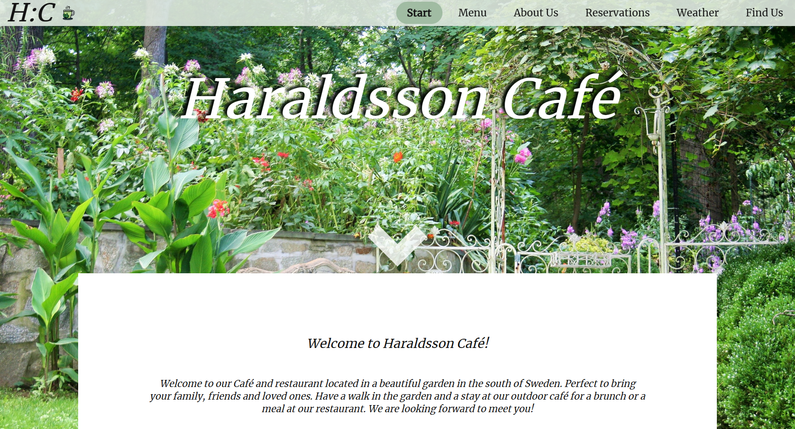
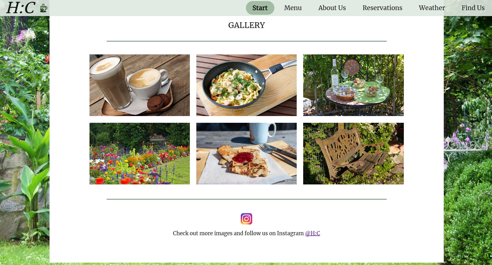
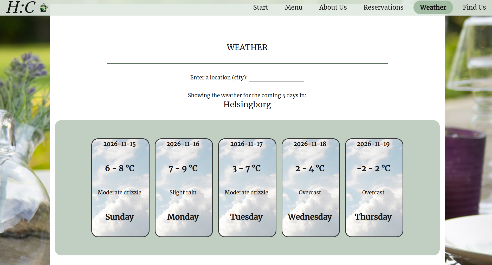
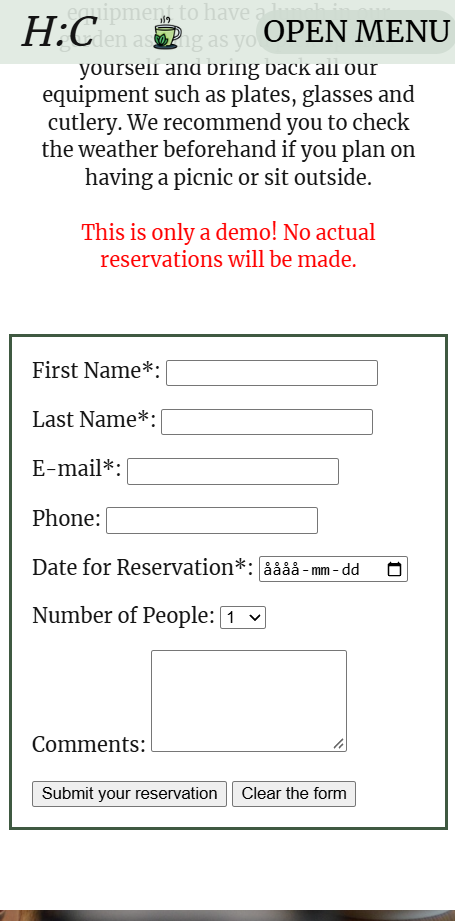

# Haraldsson Café 
"Haraldsson Café" is a fictional café website and a personal project that I developed in 2022 as part of a web development course.
It was my first experience with HTML, CSS and JavaScript, and was a fun learning experience. 

### Homepage

## Features
- Café menu: Browse food and drink options.
- Weather forecast: Search for a city and view a five-day weather forecast using the Open-Meteo API.
- Reservation form: A demo form with input validation and a confirmation page. No actual reservations are made.
- Café information: Pages with information about the café and its location.
- Interactive elements: JavaScript functionality for the website's different features.

## Technologies used
HTML5, CSS3, vanilla JavaScript, Open-Meteo API (updated in 2026) and Visual Studio Code

### Updated in 2026
In 2026, I revisited the project and replaced the original weather API with Open-Meteo to restore the weather forecast functionality. 
I also made minor updates to improve functionality and prepare the project for publication on GitHub.
The project has intentionally been kept close to the original implementation to show my earlier web development skills.

## How to run
1. Clone or download this repository.
2. Open the project folder in Visual Studio Code.
3. Install the Live Server extension if needed.
4. Right-click index.html and select Open with Live Server.

## Notes 
- This is a fictional café created for educational purposes.
- The reservation form is for demonstration only and does not store or submit real bookings.
- Weather data is provided by the Open-Meteo API.
- The project was originally created in 2022 and updated in 2026.

## Screenshots

### Gallery

### Weather Forecast

### Mobile Reservation Form

